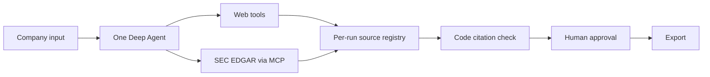

# Account Research Agent

This single-agent CLI researches a company and creates a sourced account brief plus a validated `AccountRecord`. It gathers evidence through web tools and optional SEC EDGAR MCP, checks every claim against registered sources, and writes files only after human approval.



## Citation enforcement

Every cited source ID must exist in the per-run registry. `submit_draft` validates the model's record against that registry, returns failed claims and valid IDs for one repair attempt, and drops any remaining invalid claims with a flag after the repair limit. The export tool uses only the validated pending record; it validates the `AccountRecord` again before writing.

## Quickstart

Requires Python 3.11+ and `uv`. Set `GROQ_API_KEY` and `TAVILY_API_KEY` in `.env`; add a real-name `SEC_EDGAR_USER_AGENT` to enable filings. Groq GPT-OSS 120B is the default. Gemini 3.6 Flash is a different-vendor option with a live tool-call check; use `--model gemini:gemini-3.6-flash` when Gemini credentials are available and Groq's free quota is exhausted. Full Gemini research quota remains unverified; see the [verification log](docs/verification.md).

```sh
uv sync --all-extras
cp .env.example .env  # add API keys and SEC_EDGAR_USER_AGENT
ara research "Apple" --ticker AAPL --context "selling AI workflow tools to finance teams"
```

The CLI pauses for approval before export. Add `--yes` for scripted auto-approval. Use `ara --help` to list diagnostic commands.

## Examples and verification

- [Live run history](docs/run-results.md)
- [v0.1.0 verification matrix](docs/verification.md)
- [Model spike and Groq rate limits](docs/spike/model-spike-results.md)

## Known limits

- Live Gemini runs require `GOOGLE_API_KEY`; Gemini quota and model availability depend on the Google account and region.
- Groq free-tier quotas can pause or stop a run. Same-call retries are bounded by `max_rate_limit_waits` and `max_total_wait_seconds`.
- SEC EDGAR MCP is optional and requires a valid user agent. Without it, the run marks filings unavailable.
- One agent is used; there are no subagents or LangSmith tracing integration.

The optional separately launched SEC EDGAR MCP server is AGPL-3.0; see [ADR 0002](docs/decisions/0002-mcp-for-sec-filings.md). This project is MIT licensed.
