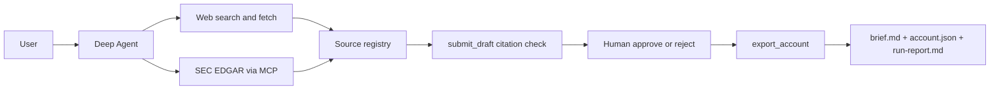

# Account Research Agent

A single-agent CLI that researches a company from public web results and SEC filing metadata, checks every factual claim against a source registry, and pauses for human approval before exporting a brief.

## Demo

Demo video: TBD.

No approved example brief exists yet. The required Apple live run was attempted but blocked by free-tier model limits, so there is no verified `examples/apple/brief.md` to excerpt.

## Why

Sales research is slow when a rep has to gather public facts, source them, and verify them before sending a customer-facing brief. This project keeps the research loop in one place and enforces a source-backed draft before anything is exported, so the final output is grounded in collected evidence instead of model memory alone.

## What it can do

- Research a company from the web with Tavily-backed search and page fetch tools.
- Pull SEC EDGAR information for US-listed companies through the MCP allowlist when enabled.
- Plan work as a skills-driven research method with a short task prompt.
- Draft a structured brief with summary, financial highlights, signals, priorities, pain points, and talking points.
- Cite each factual claim by source ID and validate those IDs in code through a per-run registry.
- Allow one repair cycle for invalid claims before final submission and drop or flag unsupported items.
- Pause for human approval or rejection before export and write only the approved data.
- Export `brief.md`, `account.json`, and `run-report.md` after approval.
- Enforce model-call, search, fetch, SEC-call, request-size, and total-wait budgets.
- Report token usage, model calls, rate-limit waits, and runtime.
- Run against the Groq default model, Gemini via optional configuration, or locally via Ollama when installed.

## How it works



1. The agent receives the company, ticker, and seller context from the CLI.
2. It collects web search results and optional SEC filing metadata, registering each source with an ID and title.
3. A `submit_draft` tool validates claim/source pairs and allows one repair pass.
4. The agent pauses for approval before the zero-argument `export_account` tool writes files.
5. The export writes only the validated pending record and a run report.

## Design decisions

- **Citations are checked in code.** The source registry is the authority, and the project intentionally avoids trusting model-generated URLs or source IDs. Claims are carried with stable IDs and later rendered with a source list in the exported brief.
- **Source IDs are used instead of raw URLs.** This prevents long, repeated URLs from inflating the request and keeps the brief easier to review and audit.
- **The project uses a single agent rather than sub-agents.** The model spike effort measured median trivial-run usage around 6,819–7,714 tokens across tested models, which was one reason to keep the orchestration compact and avoid duplicate prompts and evidence sets.
- **SEC EDGAR is accessed through MCP with a deny-by-default allowlist.** The upstream library is AGPL-3.0, so the server remains process-isolated and tool access is filtered rather than open-ended.
- **The skills are intentionally lean and the prompt is short.** The project keeps reusable method instructions in Markdown skill files and uses a concise system prompt for orchestration and evidence rules.
- **Export is gated by approval and only writes the validated record.** The application pauses at `export_account`, holds the validated pending record, and writes files only after a human approval decision.
- **Run budgets and request trimming are enforced.** The project limits model calls, search steps, page fetches, SEC calls, and total wait time, and trims older tool results while preserving source IDs and titles until the request estimate fits the configured cap. This was motivated by the 29-call free-tier run that repeatedly ran into request-size and quota pressure; see [docs/decisions/0004-default-model.md](docs/decisions/0004-default-model.md).
- **Open-weight model support is built in, but not all live-provider paths are equally verified.** Groq is the default. Gemini tool-call support exists, and Ollama support is implemented when the local model is installed. The verified live path in this workspace was Groq, and the Apple run was blocked by provider limits before a completed brief could be exported.

## Output format

The project exports a Markdown brief and a structured account record. The brief includes the company heading, summary, section claims, and a source list keyed by ID. The code schema is defined in [docs/account_record.schema.json](docs/account_record.schema.json) and the runtime model is in [src/account_research/schemas/account.py](src/account_research/schemas/account.py).

Example brief layout:

```md
# Company Name

## Summary

- ... [sources: S1, S2]

## Financial highlights

- ... [sources: S3]

## Signals

- ... [sources: S4]

## Priorities

- ... [sources: S5]

## Pain points

- ... [sources: S6]

## Talking points

- ... [sources: S7]

## Sources

- **S1** — Example title (search_result): https://example.com
```

The exported `account.json` is a validated `AccountRecord` with these fields: company name, domain, industry, public flag, summary, the claim sections, sources, flags, generated timestamp, and model name.

## Tech stack

| Area                      | Technology                                     |
| ------------------------- | ---------------------------------------------- |
| Agent and interrupts      | Deep Agents, LangGraph                         |
| Models                    | Groq, optional Gemini, optional Ollama         |
| Web research              | Tavily                                         |
| SEC filings               | `langchain-mcp-adapters`, `sec-edgar-mcp`      |
| Record validation         | Pydantic                                       |
| CLI                       | Typer                                          |
| Output rendering          | Rich                                           |
| Packaging                 | uv                                             |
| Linting and type-checking | Ruff, mypy                                     |
| Testing                   | pytest                                         |
| CI                        | GitHub Actions (project configuration present) |

## Quickstart

Prerequisites:

- macOS or Linux
- Python 3.11+
- `uv` installed
- a Groq API key in `.env`
- a Tavily API key in `.env`
- a real SEC EDGAR user-agent string in `.env`
- optional Gemini key for Gemini use
- optional Ollama install and `gpt-oss:20b` model for local runs

Commands:

```sh
uv sync --all-extras
cp .env.example .env
# Fill in ANTHROPIC_API_KEY, TAVILY_API_KEY, and SEC_EDGAR_USER_AGENT
uv run ara doctor
uv run ara research "Apple" --ticker AAPL --context "selling AI workflow tools to finance teams"
```

## Run the UI

```sh
streamlit run app.py
```

The default Groq flow is the verified hosted path in this repo. The CLI pauses for approval unless `--yes` is used. Use `--model ollama:gpt-oss:20b` when Ollama is installed and the model is present.

## CLI reference

The CLI commands are verified against the implementation:

- `uv run ara --help`
- `uv run ara doctor --help`
- `uv run ara skills --help`
- `uv run ara research --help` (options: `--domain`, `--ticker`, `--context`, `--model`, `--yes`)
- `uv run ara mcp-tools --help`
- `uv run ara tools-check --help` (option: `--ticker`)

The research command usage is:

```sh
uv run ara research {company} --domain <str> --ticker <str> --context <str> --model <str> --yes
```

## Configuration

The runtime settings are defined in [src/account_research/config.py](src/account_research/config.py) and loaded from `.env` with the `ARA_` prefix for app settings.

| Setting                   | Env var                       |                    Default | Purpose                                                |
| ------------------------- | ----------------------------- | -------------------------: | ------------------------------------------------------ |
| `model`                   | `ARA_MODEL`                   | `anthropic:claude-opus-5-5` | Default model selection                               |
| `anthropic_effort`        | `ARA_ANTHROPIC_EFFORT`        |                   `medium` | Claude thinking depth and cost (low to max)            |
| `fallback_model`          | `ARA_FALLBACK_MODEL`          |                     `null` | Optional fallback model                                |
| `max_model_calls`         | `ARA_MAX_MODEL_CALLS`         |                       `15` | Max model turns per run                                |
| `max_request_tokens`      | `ARA_MAX_REQUEST_TOKENS`      | unset: `6500` Groq, `32000` other | Cap for serialized model request size  |
| `search_budget`           | `ARA_SEARCH_BUDGET`           |                        `4` | Search actions per run                                 |
| `max_page_fetches`        | `ARA_MAX_PAGE_FETCHES`        |                        `2` | Page fetch cap                                         |
| `max_sec_calls`           | `ARA_MAX_SEC_CALLS`           |                        `4` | SEC tool call cap                                      |
| `max_search_results`      | `ARA_MAX_SEARCH_RESULTS`      |                        `5` | Max Web search results                                 |
| `snippet_chars`           | `ARA_SNIPPET_CHARS`           |                      `300` | Source snippet length                                  |
| `max_page_chars`          | `ARA_MAX_PAGE_CHARS`          |                     `3000` | Max page content kept                                  |
| `mcp_result_chars`        | `ARA_MCP_RESULT_CHARS`        |                     `3000` | Max MCP result kept                                    |
| `recursion_limit`         | `ARA_RECURSION_LIMIT`         |                       `50` | Agent recursion limit                                  |
| `request_timeout_seconds` | `ARA_REQUEST_TIMEOUT_SECONDS` |                       `60` | Request timeout                                        |
| `max_retries`             | `ARA_MAX_RETRIES`             |                        `3` | Retry count                                            |
| `max_rate_limit_waits`    | `ARA_MAX_RATE_LIMIT_WAITS`    |                        `6` | Rate-limit wait budget                                 |
| `max_total_wait_seconds`  | `ARA_MAX_TOTAL_WAIT_SECONDS`  |                      `300` | Bounded wait time for all runs                         |
| `min_output_tpm`          | `ARA_MIN_OUTPUT_TPM`          |                     `3000` | Minimum observed output throughput for fallback gating |
| `max_output_tokens`       | `ARA_MAX_OUTPUT_TOKENS`       |                     `1500` | Max output tokens for a provider response              |
| `output_dir`              | `ARA_OUTPUT_DIR`              |                   `output` | Export directory                                       |
| `skills_dir`              | `ARA_SKILLS_DIR`              |                   `skills` | Skills directory                                       |
| `mcp_config_path`         | `ARA_MCP_CONFIG_PATH`         |         `mcp_servers.json` | MCP server config                                      |
| `mcp_enabled`             | `ARA_MCP_ENABLED`             |                     `true` | Enables SEC filings tool path                          |
| `mcp_timeout_seconds`     | `ARA_MCP_TIMEOUT_SECONDS`     |                       `30` | MCP call timeout                                       |
| `log_level`               | `ARA_LOG_LEVEL`               |                     `INFO` | Logging level                                          |
| `anthropic_api_key`       | `ANTHROPIC_API_KEY`           |                      unset | Anthropic access key (default provider)                |
| `groq_api_key`            | `GROQ_API_KEY`                |                      unset | Groq access key                                        |
| `google_api_key`          | `GOOGLE_API_KEY`              |                      unset | Optional Gemini provider key                           |
| `tavily_api_key`          | `TAVILY_API_KEY`              |                      unset | Tavily access key                                      |
| `sec_edgar_user_agent`    | `SEC_EDGAR_USER_AGENT`        |                      unset | Required SEC EDGAR User-Agent                          |

## Testing and verification

Verified commands run in this workspace:

- `make check` → passed, with `71 passed` in `uv run pytest`
- `uv run ara doctor` → loaded `GROQ_API_KEY`, `TAVILY_API_KEY`, and `SEC_EDGAR_USER_AGENT`
- `uv run ara --help` and per-command help checks → all commands listed and options match the CLI implementation

See [docs/verification.md](docs/verification.md) for the live run details and provider-limit notes. The model-spike evidence is in [docs/spike/model-spike-results.md](docs/spike/model-spike-results.md) and the ADR is in [docs/decisions/0004-default-model.md](docs/decisions/0004-default-model.md).

## Known limitations

- The required live Apple run did not complete because the Groq free-tier path hit provider limits during the run; no approved Apple or Ramp example files exist yet.
- The citation check confirms that a source ID exists in the registry; it does not prove that the source proves the exact stated claim.
- The repo supports public research and SEC filing metadata for US-listed companies, but it is not a source-of-truth financial analysis engine.
- Any capacity or quota issue from the provider is external to the repo logic and can block completion of a full live run.
- Local Ollama and Gemini support are implemented but only partially verified live in this workspace.

## Project structure

```text
.
├── README.md
├── Makefile
├── pyproject.toml
├── mcp_servers.json
├── docs/
│   ├── verification.md
│   ├── decisions/
│   └── spike/
├── skills/
│   ├── account-brief/
│   └── sec-filings/
├── src/account_research/
│   ├── agent/
│   ├── checks/
│   ├── interfaces/
│   ├── mcp/
│   ├── models/
│   ├── prompts/
│   ├── schemas/
│   ├── skills/
│   ├── sources/
│   └── tools/
├── tests/
└── examples/
```

## Roadmap

1. Re-run the required Apple, Ramp, revision, and MCP-disabled approval flow once provider quota resets.
2. Save approved example outputs under `examples/` and keep run reports with them.
3. Add more industry playbook skills and reusable brief patterns without changing the verified export path.
4. Expose the same research flow as an MCP server when the project is used by tool-driven workflows.

## License

This project is MIT-licensed. The SEC EDGAR MCP server is run as a separate process and remains governed by its own AGPL-3.0 upstream license.
