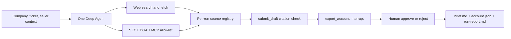

# Account Research Agent

One-line: a single-agent CLI that researches companies and prepares citation-checked account briefs for human-approved export.

## Demo

<!-- Demo recording and approved Apple excerpt will be added after live verification succeeds. -->

Apple brief excerpt: pending. The required Apple run stopped at Groq's daily token quota, so there is no approved `examples/apple/brief.md` to quote.

## Why

Sales research needs usable company context, clear evidence, and a review step before data is saved. The agent keeps each factual claim tied to a source collected during that run and gives the reviewer the final say before export.

## How it works



1. Web and optional SEC tools collect public evidence and register source IDs.
2. `submit_draft` checks every claim's source IDs against the registry and allows a repair.
3. `export_account` interrupts for approval and writes only the validated pending record.

## Design decisions

- **Check citations in code.** The registry is authoritative; model instructions alone cannot validate evidence. Claims use stable source IDs instead of repeating long URLs, while the brief ends with a source list mapping each ID to its title and URL.
- **Use one agent.** The model spike's trivial runs consumed a median 6,819–7,714 tokens per run across tested models. A second agent would repeat prompts and evidence; a single agent keeps orchestration and token use lower.
- **Use SEC EDGAR through MCP.** A deny-by-default allowlist limits tool access. The server runs as a separate process because its upstream package is AGPL-3.0; the agent can mark filings unavailable when MCP is disabled or fails.
- **Keep skills and prompt lean.** The account-brief and SEC-filings skills describe repeatable research steps, while a short system prompt keeps task-specific guidance separate from tool schemas and evidence.
- **Gate export with `interrupt_on`.** The agent pauses at a zero-argument export tool. The application holds the citation-checked record and writes it only after approval.
- **Bound research and request size.** Search, page-fetch, SEC-call, and model-call budgets prompt the agent to draft early. Middleware trims older tool results while preserving source IDs and titles; the newest tool result stays intact. Live Groq checks have stayed within the 6,500-token estimate, but a complete brief is not yet verified.
- **Support hosted and local open-weight models.** Groq GPT-OSS 120B is the default; `--model ollama:gpt-oss:20b` is available when Ollama and that model are installed. Ollama was not installed in the verification environment. A minimal Gemini tool call worked, but Gemini full-run quota was unreliable, so Gemini is not the documented fallback.

## Tech stack

| Area | Technology |
|---|---|
| Agent and interrupts | Deep Agents, LangGraph checkpointer |
| Models | LangChain Groq, optional LangChain Ollama, optional Google GenAI |
| Web research | Tavily search and extraction |
| Filings | SEC EDGAR MCP adapter with tool allowlist |
| Record and checks | Pydantic `AccountRecord`, code-level citation registry |
| CLI and tests | Typer, pytest, Ruff, mypy |

## Quickstart

Requires Python 3.11+ and `uv`. Configure `GROQ_API_KEY`, `TAVILY_API_KEY`, and a real-name `SEC_EDGAR_USER_AGENT` in `.env` for hosted Groq, web search, and EDGAR filings.

```sh
uv sync --all-extras
cp .env.example .env  # then set the required keys
ara research Apple --ticker AAPL --context "selling AI workflow tools to finance teams"
```

The CLI pauses for approval. Use `--yes` for scripted auto-approval or `--model ollama:gpt-oss:20b` for a local Ollama model.

## Results

| Verification | Status |
|---|---|
| Offline `make check` | Passed, 71 tests |
| Gemini 3.6 Flash minimal tool call | Passed, 50 tokens |
| Apple full run on Groq free tier | Stopped on daily token quota; no brief |
| Request estimate cap | Kept sent requests at or below 6,500 tokens in the latest run |
| Approved Apple/Ramp examples | Not available |

See [verification details](docs/verification.md), [live run history](docs/run-results.md), and [model spike results](docs/spike/model-spike-results.md).

## Known limitations

- Groq free-tier daily quota can stop full research. The latest Apple attempt exhausted it; live checks for Ramp, Apple revision, and MCP-disabled Apple remain unrun.
- No approved Apple or Ramp example exists yet. `v0.1.0` is not tagged until required Apple approval succeeds.
- Local Ollama support is implemented but was not live-tested here. Gemini's tool API worked once, but full-run quota was not reliable.
- SEC EDGAR needs the optional process and a valid SEC user agent. Missing filings are flagged.

## Structure

`src/account_research/` contains the CLI, agent, models, tools, source registry, and schema. `skills/` contains the agent's Markdown methods. `tests/` holds the offline regression suite; `docs/` contains ADRs and verification evidence; `examples/` will hold approved exports.

## Roadmap

1. Finish required free-tier Apple, Ramp, revision, and MCP-disabled live checks.
2. Save approved Apple and Ramp examples with run reports.
3. Tag `v0.1.0` after the required Apple approval run passes.

## License

This project is MIT licensed. The separately run SEC EDGAR MCP server is AGPL-3.0 and remains process-isolated.
