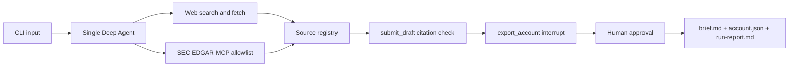

# Architecture

The CLI creates one Deep Agent per research run. Web search/fetch tools and optional allowlisted SEC EDGAR MCP tools add deduplicated sources to a run-scoped registry. The agent submits an `AccountRecord`; application code checks every claim's source IDs and allows one repair submission. The agent then calls the zero-argument `export_account` tool, which interrupts for human approval and writes only the validated pending record after approval.

`RateLimitMiddleware` inspects available rate-limit headers, estimates request input tokens, waits before over-budget calls, and retries a 429 on the same model. Waits are bounded by both the per-call retry count and a run-wide wait cap. Model fallback is limited to unavailable models or repeated server errors, with a header-verified output-token threshold. Gemini is an optional provider through `langchain-google-genai`.

Research tools are read-only; `export_account` is the sole output writer. MCP is optional, separately launched, and filtered by a deny-by-default allowlist. Missing MCP services are reported through account flags.
